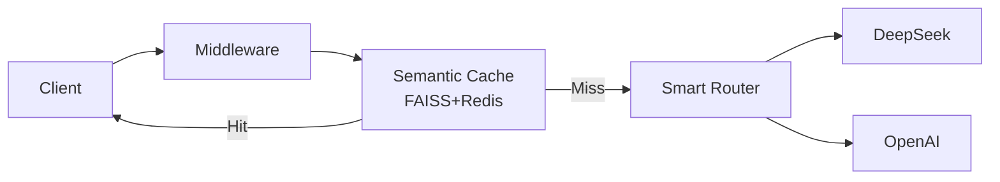

# Neurocache 🧠⚡️

[](https://github.com/neurocache/neurocache/actions)
[](https://hub.docker.com/r/neurocache/neurocache)
[](https://opensource.org/licenses/MIT)

**Cut your LLM bill by 70% without touching your code.**

Neurocache is an open-source, AI-Native Semantic Cache and Multi-Provider Cost Router. It acts as an OpenAI-compatible proxy that intelligently caches responses and routes requests to the most cost-effective provider without sacrificing quality or latency.

## Why Neurocache?

If you are using LLMs in production, you are probably paying too much. 

*   **Stop paying for the same answer twice:** Neurocache uses semantic similarity (powered by FAISS and local embeddings) to recognize when a user asks a question you've already answered, even if they phrase it differently. 
*   **Stop using expensive models for easy tasks:** Our Smart Router dynamically shifts traffic to cheaper models (like DeepSeek V3 or Gemini 2.5 Flash) while reserving GPT-4o for complex reasoning.

### Feature Comparison

| Feature | Neurocache | LiteLLM | Kong | Raw API |
| :--- | :---: | :---: | :---: | :---: |
| **OpenAI Compatible API** | ✅ | ✅ | ✅ | ❌ |
| **Multi-Provider Routing** | ✅ | ✅ | ✅ | ❌ |
| **Semantic Caching (FAISS)**| ✅ | ❌ (Exact Match Only) | ❌ | ❌ |
| **Multi-Objective Routing** | ✅ (Cost+Lat+Rel) | ❌ (Single Obj) | ❌ | ❌ |
| **A/B Testing** | ✅ (Thompson) | ❌ | ❌ | ❌ |
| **Drift Detection** | ✅ | ❌ | ❌ | ❌ |

## Quick Start (30 Seconds)

Get up and running locally with Docker Compose:

```bash
# 1. Clone the repo
git clone https://github.com/neurocache/neurocache.git
cd neurocache

# 2. Add your API keys to .env
echo "OPENAI_API_KEY=sk-..." > .env
echo "DEEPSEEK_API_KEY=sk-..." >> .env

# 3. Start the stack
docker-compose up -d
```

Your OpenAI-compatible endpoint is now running at `http://localhost:8000/v1/chat/completions`.

Just point your OpenAI SDK to it:
```python
from openai import OpenAI

client = OpenAI(
    base_url="http://localhost:8000/v1",
    api_key="tenant_default" # Neurocache API Key
)

response = client.chat.completions.create(
    model="gpt-4o",
    messages=[{"role": "user", "content": "Explain quantum computing"}]
)
print(response.choices[0].message.content)
```

## Architecture


*(See `docs/architecture.md` for the full system design).*

## Built from First Principles

Neurocache isn't just a proxy; it's built on strong theoretical foundations:
*   [Semantic Cache Theory](docs/semantic-cache-theory.md)
*   [Routing Algorithm Derivation](docs/routing-algorithm.md)

## Dashboard
Access the real-time analytics dashboard at `http://localhost:3000` to see your cost savings, cache hit rates, and provider latency heatmaps.

## License
MIT
